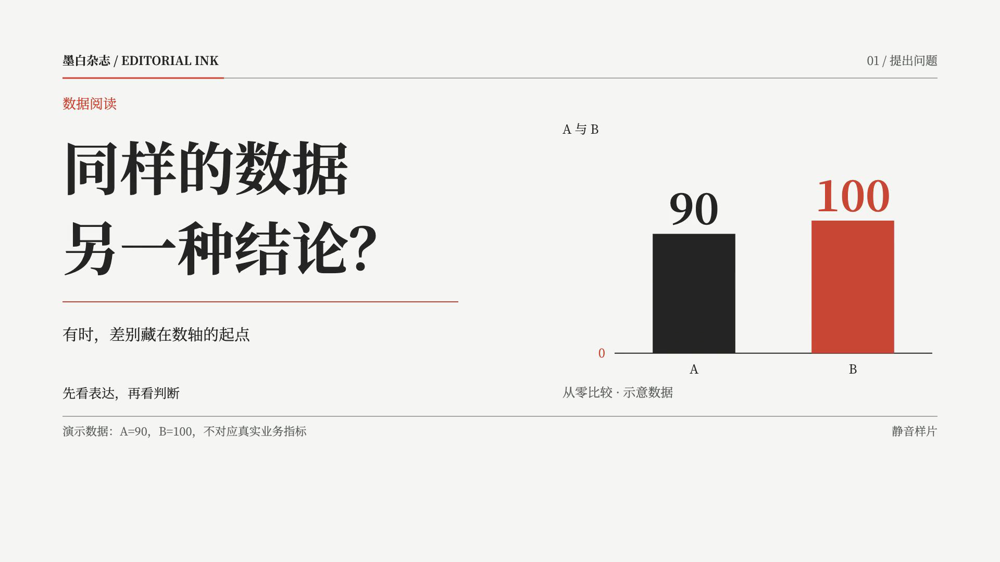
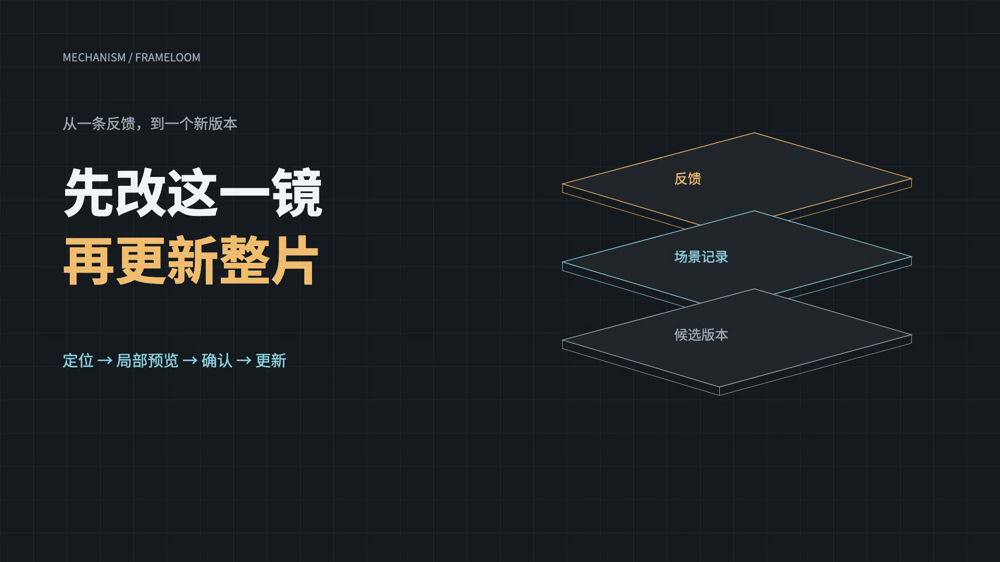
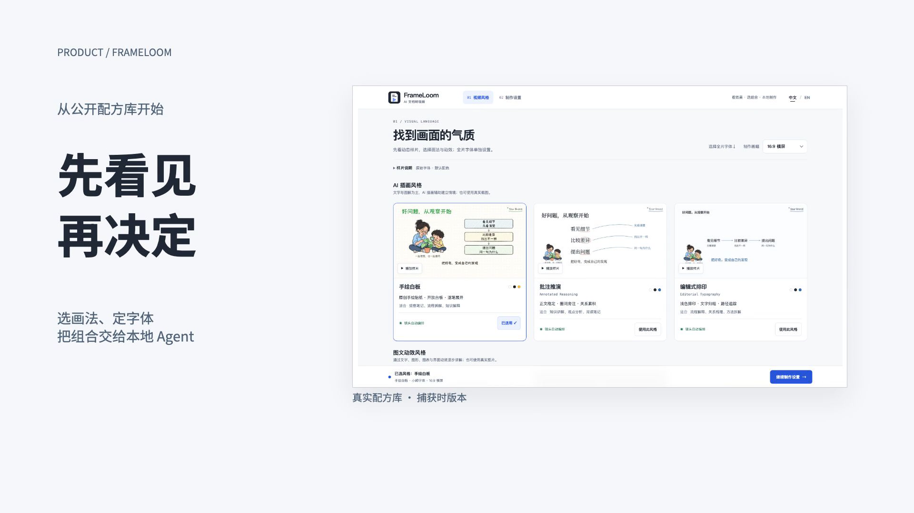
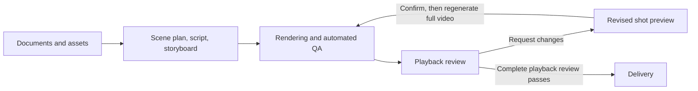

<div align="center">

[简体中文](README.md) · [English](README.en.md)


<h1>FrameLoom</h1>

**From source documents to scripts, storyboards, review, and video delivery**

A local video production workflow for Codex, Claude Code, and other coding agents

[](https://acorn2.github.io/frame-loom/)
[](https://github.com/Acorn2/frame-loom/actions/workflows/ci.yml)
[](LICENSE)
[](package.json)

[See the results](#see-the-results) · [Production workflow](#production-workflow) · [Make your first video](#quick-start) · [Browse styles](https://acorn2.github.io/frame-loom/) · [Installation and troubleshooting](references/installation.en.md) · [More from the creator](#more-from-the-creator)

</div>

**FrameLoom is a local video production workflow run by a coding agent.** Supply an article, script, or product material. The agent prepares a scene plan, script, and storyboard, adds voiceover when requested, and gives you a video to review. Leave feedback at a timecode, confirm revised shot previews, then generate the updated full video. Deliver a silent preview, clean visuals for an external editor, or a narrated video.

You install and invoke the workflow through a **Skill**. Remotion renders diagrams and animation locally from the storyboard. Each project keeps its creative plan, asset sources, review feedback, and delivery records so you can continue in another chat. A shared series profile supports recurring episodes.

## See the results

**Start with what you want to explain.** The editorial, mechanism and product samples use registered production recipes. All three are 40-second, 1080p silent videos for reviewing composition, information reveals and framing.

| Articles, arguments and data | Mechanisms, processes and systems | Product demos and tutorials |
| --- | --- | --- |
| [](examples/scenario-directions/previews/editorial.mp4) | [](examples/scenario-directions/previews/mechanism.mp4) | [](examples/scenario-directions/previews/product.mp4) |
| Read sources → compare evidence → rescale continuously → conclude | Engineering layers → overall path → timeline targeting → local confirmation | Watch samples → choose a font → copy instructions → produce locally |
| [Watch the editorial sample](examples/scenario-directions/previews/editorial.mp4) | [Watch the mechanism sample](examples/scenario-directions/previews/mechanism.mp4) | [Watch the product sample](examples/scenario-directions/previews/product.mp4) |

More visual references:

- **Articles, arguments and script explainers:** [Editorial Typography · 18 seconds · silent](examples/template-families/previews/editorial-typography-text-led.mp4), showing words moving, regrouping and connecting.
- **Knowledge and storytelling:** [Children’s nature museum case · 68 seconds · narrated](examples/nature-museum-case/previews/nature-museum-narrated.mp4), combining whiteboard writing, illustrations and a four-stage diagram. [Materials and sources](examples/nature-museum-case/README.en.md)

[Browse by use case](https://acorn2.github.io/frame-loom/) · [Recipe samples and asset sources](examples/scenario-directions/README.md). Product screenshots retain the interface at capture time; navigation may change between versions. Mechanism timestamps and scene numbers, and the editorial sample’s values 90 and 100, are explicitly illustrative rather than observed business data. Public samples do not constitute delivery approval; finished work still requires full playback review. The live site receives these entry points when this version is published.

## What can you make?

| Your source | Possible videos |
| --- | --- |
| Articles, notes, scripts | Knowledge explainers, viewpoints, and methods |
| Product documents and real screenshots | Feature explanations, steps, and workflows |
| Reports and sourced data | Summaries, comparisons, processes, and data diagrams |

For creators who already use Codex, Claude Code, or another coding agent and want to turn written material into explainers. **v0.5 is a public beta.** The supported visuals focus on text, diagrams, and real assets; live action, narrative films, and complex 3D scenes are outside the current scope.

## Production workflow



The agent plans content, runs tools, and reports check results. You review the content, request changes, and approve delivery. In `fast` mode the agent proceeds after writing the storyboard; in `review` mode it waits for your script and storyboard approval. Both modes retain playback review and delivery checks.

| What you need | How to work together |
| --- | --- |
| Review an outline or script first | Stop at the document stage. New 2.4 projects export a script and scene review sheet from the scene plan, with sources, narration, and visual intent side by side. [Planning and review (Chinese)](references/usage-guide.md#逐场计划讲稿与审阅表) |
| Continue in another chat | Give the agent the project directory and ask it to check the production status first. It identifies the current file, pending work, and who acts next. [Resume a project (Chinese)](references/usage-guide.md#接手已有项目) |
| Leave feedback while watching | Pause in the local player and record an issue against its timecode, scene, and video version. Review the revised shot and downstream timing or caption changes before authorizing the full render. [Review and revisions (Chinese)](references/usage-guide.md#边看边提意见按镜头复核新版) |
| Produce a recurring series | Reuse character assets, style, font, brand, drawing guide, and a fixed ending. Each episode retains its own sources and configuration snapshot; profile updates affect future episodes. [Series production (Chinese)](references/usage-guide.md#基于系列新建一期) |

Production and review take place in the local project. Use the online library to watch samples, choose a style, and copy instructions. The agent interprets your material; you check facts, pronunciation, and visual results during review.

## Quick start

### 1. Install and open your agent

Prepare **Git, Node.js 24+, and FFmpeg / ffprobe**. Node.js 24 LTS is recommended. Follow the [installation guide](references/installation.en.md) if you need setup commands or version checks.

```bash
git clone --depth 1 https://github.com/Acorn2/frame-loom.git
cd frame-loom
npm ci
```

Open the entire `frame-loom` repository in your coding agent:

| Agent | How to use it |
| --- | --- |
| Codex | Start a session in this repository and ask it to use the frame-loom Skill |
| Claude Code | Run `claude --plugin-dir .` from the repository root, then invoke `/frame-loom:frame-loom` |
| Other coding agents | Ask it to read the root [SKILL.md](SKILL.md) and execute commands from this directory |

The first silent preview needs no TTS configuration or API key. The first render may download a browser. Prepare access to your chosen coding agent separately; its charges depend on that service.

<details>
<summary>Check rendering first: use the prepared sample without an agent</summary>

Run in your terminal:

```bash
npm run render:storyboard -- examples/creator-production-pilot/storyboard.json .tmp/quick-start/preview-silent.mp4 --mode fast
npm run inspect:output -- .tmp/quick-start/preview-silent.mp4 examples/creator-production-pilot/storyboard.json
```

After `OUTPUT OK`, open `.tmp/quick-start/preview-silent.mp4` in a local player. Expect a 1920×1080, 30 fps, 20-second silent video. The output directory is created automatically. Use a new filename when repeating this run. This route uses an existing storyboard; continue below to try document planning.

</details>

### 2. Try the bundled document

You do not need your own source file yet. Paste this into the **agent chat**:

```text
Use the frame-loom Skill to read examples/creator-production-pilot/source/source.md.
Make a 16:9 silent preview in Editorial Ink style (retro-zine).
Use fast mode, recommend shots from the document, and continue production directly.
Give me a working local review-player link, the actual video path, duration, check results, and next action.
```

The agent creates a `projects/YYYYMMDD-topic/` project, preserves the source, writes a scene plan, exports the script and review sheet, then prepares the storyboard, renders, and runs QA. **The preview result is that project's `output/preview-silent.mp4`, a working local review-player link, and its actual duration and check results.** The video has a review marker and no audio; its content and duration depend on the agent's plan.

You do not need to write JSON, create project directories, or select every shot. Pause and record an issue in the player, or tell the agent which scene to change. Continue in the same project, review the revised shot, then confirm before generating the updated full video.

### 3. Use your own material

Replace the placeholder with a path to an existing Markdown or plain-text document, or attach the file:

```text
Use the frame-loom Skill to turn <document path> into a landscape silent preview.
Recommend a style and shots from the content, use fast mode, and continue production.
Give me a local review-player link, the video path, duration, check results, and next action.
```

Attach product screenshots if available, or provide an exact URL for the agent to capture. Subject-product screenshots guide the colors by default, while the style controls composition and motion. Ask to “use the style's default colors” if you prefer. To review before rendering, request “review mode: show the script and storyboard, then wait for my approval.”

## Choose a style

Start in the library with **product tutorials, mechanisms and processes, articles and arguments, or knowledge and stories**. Watch the corresponding sample, then choose the visual direction, font and production settings. Use-case filters only affect browsing and preserve production choices.

The original six text and graphics styles form three main directions:

| Direction | Base style and new recipe | Suitable materials |
| --- | --- | --- |
| Editorial explainers | Editorial Ink `retro-zine`, with optional `editorial-explainer`; Swiss Blue is an additional appearance | Articles, arguments, reports and sourced data |
| Mechanism diagrams | `signal-noir`, with optional `mechanism-map` | Supported processes, system structures and relationships |
| Product showcase | `studio-frame`, with optional `product-showcase` | Product information, real screenshots and operation states |

Signal `signal` provides a dark appearance, Swiss Blue `archive-grid` belongs to editorial explainers, and Sketch Notes `scatterbrain` belongs to drawn explainers. Find them under “More appearances and legacy styles.” **All previous IDs, recipe versions and projects remain supported. Existing storyboards are neither remapped nor migrated automatically.**

Whiteboard, Annotated Reasoning and Editorial Typography remain available and are recommended by use case. Their document-only route requires actual illustration generation; the screenshot route uses real assets without automatic image generation. Their [fixed built-in workflows](references/primary-style-production.md) remain intact. Fonts are independent; Annotated Reasoning and Editorial Typography prioritize text and relationships, with auxiliary illustration bounds totaling at most 8% of the canvas.

`editorial-explainer`, `mechanism-map` and `product-showcase` initially support 16:9 and their respective styles above. The original six retain their existing portrait capabilities; unsupported combinations fail instead of silently falling back. See the [recipe guide](references/direction-recipes.md) and [font catalog](fonts/README.md).

For example, start a mechanism explainer in your agent:

```text
Use the frame-loom Skill to create a landscape silent mechanism preview from my document.
Use signal-noir. Evaluate mechanism-map and other compatible recipes after reading the source;
only show supported relationships. Continue in fast mode and provide a local review link,
the check results and the next action.
```

For a product tutorial, use `studio-frame`, provide real screenshots or an exact URL, and ask the agent to evaluate `product-showcase`. The agent recommends recipes after reading the material; explicit manual pools remain strict allowlists.

Chinese and English library instructions preserve the same parameters. Switching interface language retains choices and does not authorize translating the script. Samples keep their original text and attribution. The website supports browsing, selection and instruction copying; video production runs locally.

## Continue from preview to finished video

| Desired result | Next step and output |
| --- | --- |
| A narrated video | Configure one of [Doubao TTS (provided through Volcengine), OpenAI, ElevenLabs, Alibaba, or MiniMax (Chinese guide)](references/tts-setup.md), or provide matching external voiceover; output: `output/pilot-audio.mp4` |
| Clean visuals for an external editor | Ask for a visual master; output: `output/visual-master-vNNN.mp4`, without audio, narration captions, or review markers, plus script and shot timings |
| Record voiceover before making visuals | Ask for a script handoff; output: `output/script-handoff/`, then bring your recording back |

Once TTS is configured, continue in the same project:

```text
Continue with a narrated version in the project we just created, using configured real TTS.
If several configurations are available, let me choose one.
Align the visuals to the measured voiceover duration, render, and run QA.
```

See the [usage guide (Chinese)](references/usage-guide.md) for configuration, external voiceover, and approval. Narrated deliveries and visual handoffs require your full playback review. Automated QA does not verify every fact, pronunciation, or visual decision.

For further adjustments, ask the agent to arrange captions and shots using [measured speech timing (Chinese)](references/speech-driven-production.md). The three AI illustration styles also support a top-right brand name or local logo, shared by the video and its cover; see [brand settings (Chinese)](references/branding.md).

## Common questions

**Can source labels and diagram notes appear in English?** Ask the agent to set `project.language` to `en`. Omit it or use `zh` for Chinese system labels. This setting is independent of the library interface language; it does not translate scripts, body text, or captions, or change fonts and TTS language. See [rendered UI language](references/storyboard-schema.md#rendered-ui-language).

**Do I need to write code or storyboard JSON?** No manual authoring is required. You need to install local tools, use a coding agent, and check its output. The CLI and JSON are the agent's working interface.

**Do I need voiceover? Are there charges?** The first silent preview needs no voiceover. Configure just one TTS provider if you want narration. Agent and TTS charges depend on their services; local rendering does not call a generative video API.

**Does it support portrait video?** The six text and graphics motion styles support both 16:9 landscape and 9:16 portrait. They share 43 landscape scene recipes; Editorial Ink, Mechanism diagrams and Product showcase each add one dedicated landscape recipe. Portrait supports semantic diagrams, type and filter, AI response generation, and unit-dot regrouping. The three AI illustration styles currently support landscape only and follow their built-in workflows. See the [shot catalog (Chinese)](shots/README.md) for compatibility.

**Are documents uploaded to the library website?** The website does not receive documents. Rendering is local; your chosen agent or TTS service may receive source content or narration according to its configuration and terms.

**Why is a project larger than its video?** It also keeps assets, audio, review images, caches and revision records. New review packages use full-resolution JPEGs and share repeated frames; revisions use compact archives. Run `npm run inspect:storage -- projects/<id> --duplicates` for a read-only size and duplicate report. Existing directories are not automatically cleaned; see [storage management (Chinese)](references/artifact-storage.md).

**What if setup fails or the result needs improvement?** Start with [troubleshooting](references/installation.en.md#troubleshooting). Then submit a [setup or runtime issue](https://github.com/Acorn2/frame-loom/issues/new?template=setup-problem.yml) or [video feedback](https://github.com/Acorn2/frame-loom/issues/new?template=video-feedback.yml).

## Guides and contributions

- [Documentation index (Chinese)](references/README.md): installation, production, technical references, and maintenance.
- [Installation and troubleshooting](references/installation.en.md): English instructions for local tools, the first render, and agent loading.
- [Usage guide](references/usage-guide.md), [TTS setup](references/tts-setup.md), and [screenshot colors](references/project-palette.md): detailed guides, currently in Chinese.
- [Shared Skill](SKILL.md): agent workflow, primarily in English. [Shot catalog](shots/README.md) and [storyboard contract](references/storyboard-schema.md): technical references, currently in Chinese.
- [Contributing](CONTRIBUTING.md), [changelog (Chinese)](CHANGELOG.md), and [security reporting (Chinese)](SECURITY.md).

<details>
<summary>Developers: current shot capabilities</summary>

The runtime registers 55 scene recipes, 9 hosted actions, and 5 chapter transitions; 48/48 shortlist candidates are adapted. The registered total includes historical compatibility recipes; style support and fixed new-project workflows constrain actual selection. Scene recipes and presets remain experimental. The [capability manifest](src/renderer/capability-manifest.ts) defines supported combinations. See the [optional explainer preset](video-templates/retro-zine-explainer/guide.md) and [local library guide](library/README.md) for technical details (Chinese).

</details>

## More from the creator

FrameLoom is maintained by **[Hresh赫什](https://hreshhao.com/)**. I'm an independent developer building products with AI and sharing what I learn about productivity tools and finding an initial audience. Here are some of my other products (the linked introductions are in Chinese):

| Product | What it helps you do |
| --- | --- |
| [儿童 3D 自然博物馆 / Children's 3D Nature Museum](https://hreshhao.com/products/nature-museum/) | Explore rotatable 3D models, listen to nature stories, and discuss observations with children. This is the product featured in the video case above. |
| [收链 / LinkBox](https://hreshhao.com/products/linkbox/) | Save links through the iOS share sheet, then organize them with tags, search, and duplicate cleanup in a local link organizer. |
| [TabNest](https://hreshhao.com/products/tabnest/) | Turn Chrome's new tab page into a workspace for tabs, bookmarks, and restorable browsing sessions. |
| [ReadCover / 阅读掩护](https://hreshhao.com/products/readcover/) | Read local TXT / EPUB files with a Word-style interface, protection when the window loses focus, and a quick hide shortcut. |
| [通辽宇宙知识库 / Tongliao Universe Knowledge Base](https://hreshhao.com/products/tongliao-universe/) | Explore connected records of people, countries, history, memes, and music from 小约翰可汗's videos. |

[Explore the full product portfolio →](https://hreshhao.com/products/) · [Open the product workbench →](https://hreshhao.com/workbench/)

The portfolio also includes 读镜 / READFRAME, 亲友记 / KinKeep, 组局记 / Better Gathering, and other projects. Visit the website for each product's introduction, current status, and access links.

## Credits and licenses

- [Remotion](https://www.remotion.dev/) provides deterministic video rendering with React.
- [video-shotcraft](https://github.com/Vincentwei1021/video-shotcraft) informed shot recipe methods and the presentation structure. Individual `provenance.json` files and the [coverage ledger](shots/shortlist-coverage.json) record sources and adaptation licenses.
- [whiteboard-video](https://github.com/trustfuture/simon-skills/tree/3ad0a25127c17da48a0e869c9efbf4136c40848b/skills/whiteboard-video) informed whiteboard drawing and production methods; the [original MIT notice](references/licenses/simon-whiteboard-MIT.txt) is retained.
- Bundled fonts retain original copyright notices and SIL OFL 1.1 licenses; see the [font directory](fonts/README.md).

FrameLoom's own code is [MIT licensed](LICENSE). Remotion has a separate [official license](https://www.remotion.dev/license). Fonts, images, music, and TTS output follow their own terms; FrameLoom's MIT license does not replace them.

PPT Master’s blueprint composition, artifact-first product presentation and semantic motion methods informed the three new recipes. FrameLoom’s code and graphics are original; no upstream media was copied. Source and MIT license links are retained in the [editorial-explainer](shots/editorial-explainer/provenance.json), [mechanism-map](shots/mechanism-map/provenance.json) and [product-showcase](shots/product-showcase/provenance.json) records.
